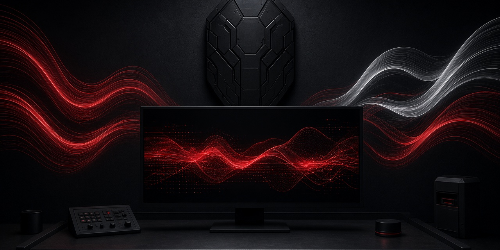

<p align="center">
  
</p>

<h1 align="center">OpenShield Desktop</h1>

<p align="center">The GUI companion for the OpenShield AI coding harness: sessions, streaming chat, tool approvals and swarm monitor. Part of the Blackshield Company.</p>

<p align="center">
  <a href="https://github.com/Blackshield-Company/openshield-desktop/actions/workflows/ci.yml"></a>
  <a href="LICENSE"></a>
  <a href="https://github.com/Blackshield-Company/openshield"></a>
</p>

Pocket, the Android remote, is built from this codebase; its Android target lives in [openshield-mobile](https://github.com/Blackshield-Company/openshield-mobile).

## Stack

- **Tauri 2** (Rust shell in `src-tauri/`) — app ID `com.openshield.desktop`
- **SvelteKit 2** (adapter-static, SPA mode) + **Svelte 5** + **TypeScript**
- Frontend talks to `openshield serve` (axum REST + WS, port 9310) directly
  over HTTP/WebSocket — the same code path runs on desktop, Android, and
  browser dev. No Tauri IPC for backend traffic.

The original Flutter scaffold is preserved in git history only; design doc
§8 decision 5 (Tauri + SvelteKit) supersedes it.

## Layout

```
openshield-desktop/
├── docs/                 # design doc + vendored reference configs
├── scripts/              # icon generation (python3 + PIL)
├── src/
│   ├── app.html / app.css
│   ├── lib/
│   │   ├── services/backend.ts   # REST+WS client (§3.1 / §4 contract)
│   │   ├── themes.ts             # CSS-variable theme store
│   │   └── components/
│   └── routes/           # chat, sessions, approvals, swarm,
│                         # memory, doctor, settings
├── static/               # favicon + assets
└── src-tauri/            # Rust shell (window, CSP, icons, capabilities)
```

## Themes

CSS variables + Svelte store, swapped via `data-theme` on `<html>`:

- **Blackshield** (flagship): `#101014` matte black, `#8F959C` steel,
  `#C1121F` blood, `#D8D3C8` bone.
- **Synthwave '84**: `#240037`, `#8F00FF`, `#FF7EDB`, `#FF00FF`, `#F3E70F`.

## Auth

`openshield serve` requires a bearer token on every host, including
localhost. HTTP uses `Authorization: Bearer <token>`; the WebSocket
handshake uses `?token=`. A missing or bad token is HTTP 401. Desktop reads
`~/.config/openshield/desktop.token` when the host is local and no token is
saved. Pocket pairs by pasting the `POST /api/v1/pair` payload (master token
only; 429 if rate-limited). A rejected token shows a re-pair banner.

## Develop

```sh
npm install
npm run dev          # vite dev server on :1420
npm run tauri dev    # full Tauri window
npm run check        # svelte-check
npm run build        # static build → build/
```

App icons come from the shared brand system ([docs/brand](docs/brand/README.md)).
Regenerate them with:

```sh
npx tauri icon docs/brand/tile-512.png
```

## Milestones

See `docs/openshield-desktop-design.md` §7. M1 (desktop shell) is complete:
adaptive nav, theme system, backend client with disconnected banner, Doctor
panel (live + mock fallback), Settings (connection, theme, pairing, credit).

## License

MIT © 2026 Blackshield Company
